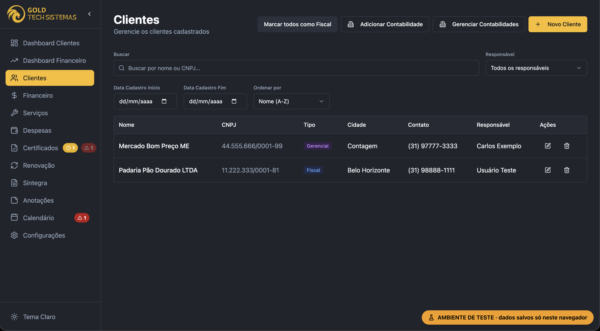
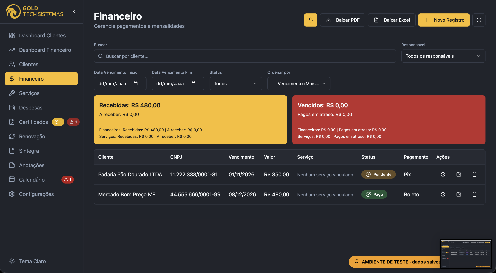
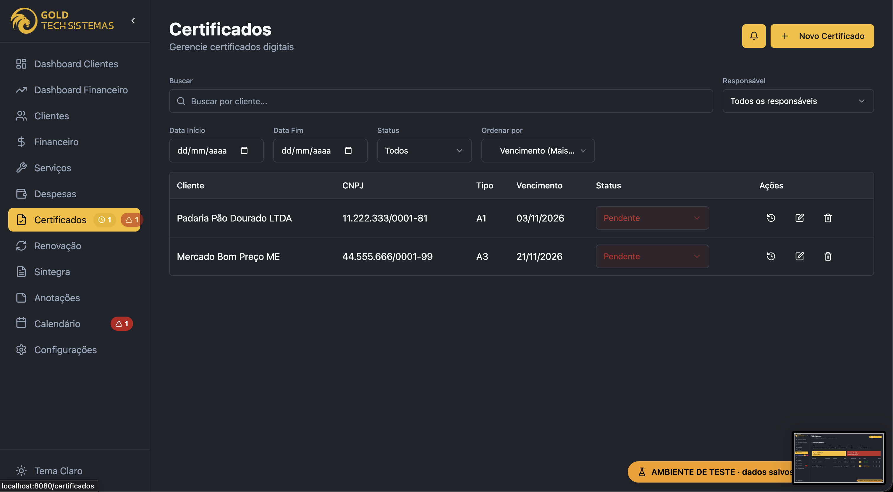
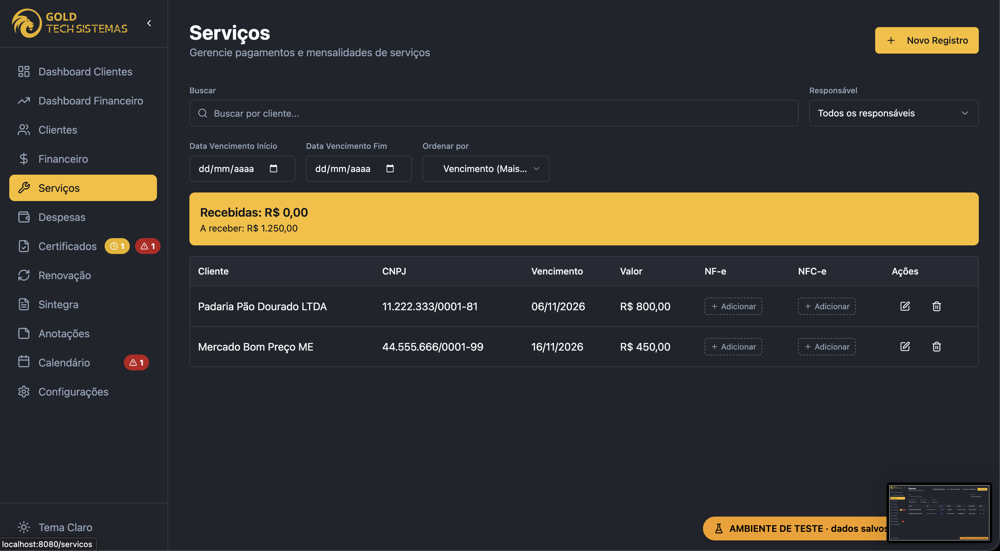
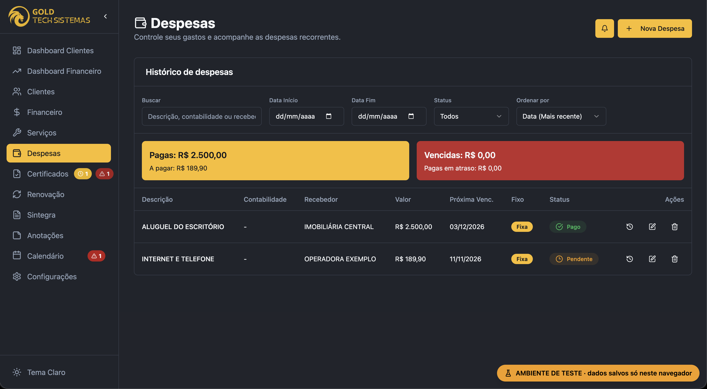
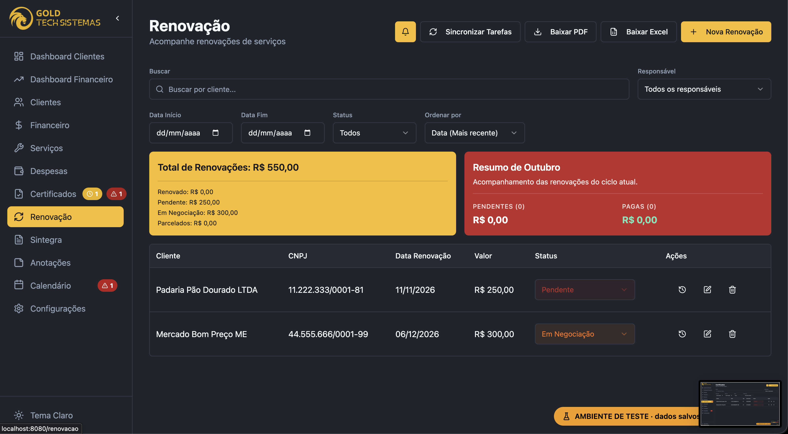
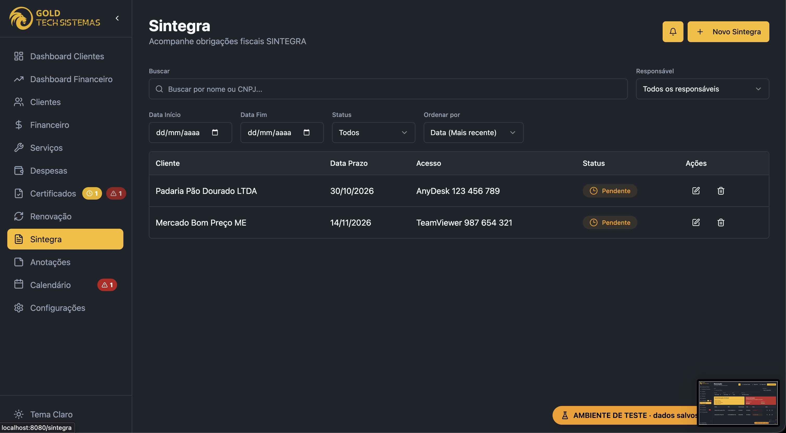
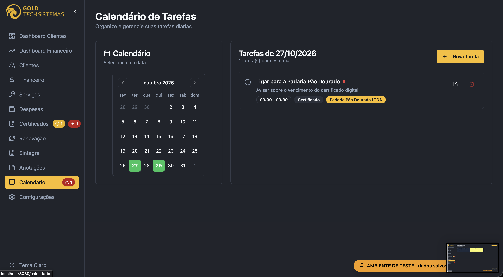

# 🚀 Client Sync Forge — Gestão para Escritórios de Contabilidade

Sistema web (CRM/ERP) para escritórios de contabilidade e prestadores de serviço controlarem **clientes, mensalidades, serviços, despesas, certificados digitais, renovações e Sintegra** em um painel único, com alertas automáticos de vencimento.

> 🧪 **Esta é a versão de demonstração.** Ela roda **sem banco de dados e sem login**: tudo fica salvo no navegador de quem acessa (localStorage) e o sistema já vem com dados de exemplo. A versão original roda em produção com Firebase (Firestore + Authentication).

<!-- 📸 FOTO PRINCIPAL: salve a imagem em docs/screenshots/capa.png -->
<p align="center">
  
</p>

<p align="center">
  <a href="#-demonstração">Demonstração</a> •
  <a href="#-funcionalidades">Funcionalidades</a> •
  <a href="#-telas">Telas</a> •
  <a href="#-tecnologias">Tecnologias</a> •
  <a href="#-como-rodar">Como rodar</a> •
  <a href="#-arquitetura">Arquitetura</a>
</p>

---

## 🌐 Demonstração

🔗 **Acesse:** _[coloque aqui o link do site publicado]_

- Não precisa criar conta nem fazer login.
- Na primeira visita, o sistema carrega **2 registros de exemplo em cada módulo**.
- Tudo o que você cadastrar, editar ou excluir fica salvo **apenas no seu navegador**. Exemplos excluídos não voltam.
- Para recomeçar do zero, limpe os dados do site nas configurações do navegador.

---

## 📋 Sobre o projeto

Antes do sistema, o escritório controlava clientes, certificados digitais, prazos do Sintegra e mensalidades em planilhas e anotações, com risco real de perder prazos. O Client Sync Forge centraliza essas informações e avisa com antecedência o que está para vencer.

**Problemas que ele resolve:**

- Certificados digitais vencendo sem ninguém perceber
- Mensalidades e serviços sem controle claro de quem pagou, quando e se foi em dia
- Prazos de Sintegra espalhados em planilhas
- Despesas fixas do escritório sem histórico de pagamento
- Falta de visão geral (quanto entrou, quanto falta receber, o que está atrasado)

---

## ✨ Funcionalidades

### 👥 Clientes e contabilidades
- Cadastro de clientes com CNPJ, cidade, contato, responsável e contabilidade parceira
- Classificação do cliente como **Fiscal** e/ou **Gerencial**
- Busca por **nome ou CNPJ** (com ou sem pontuação)
- Ao editar o nome ou o CNPJ, a mudança é **propagada automaticamente** para financeiro, serviços, certificados, renovações e Sintegra
- Exclusão lógica (*soft delete*): o histórico contábil é preservado

### 💰 Financeiro (mensalidades)
- Controle de mensalidades por cliente com status **Pago / Pendente / Vencido**
- Ao pagar, o vencimento avança automaticamente para o mês seguinte
- O item continua como **Pago** durante o mês do pagamento e só volta a **Pendente** no mês seguinte
- **Histórico de pagamentos** com data, meio (Pix/Boleto) e indicação de pagamento **em dia** ou **atrasado**
- Desfazer pagamento remove sempre o **último pagamento registrado**
- Totais de recebido, a receber, vencido e pago em atraso
- Exportação para **PDF** e **Excel**

### 🛠️ Serviços
- Serviços avulsos por cliente (abertura de filial, regularização etc.)
- Controle de NF-e e NFC-e por serviço
- Filtros por responsável, período e status

### 💸 Despesas
- Despesas **fixas** (recorrentes, avançam mês a mês) e **avulsas**
- Histórico de pagamentos com status em dia/atrasado
- Filtros por período, status e recebedor

### 📄 Certificados digitais
- Controle de certificados **A1** e **A3** por cliente
- Alertas visuais na barra lateral:
  - 🟡 vencendo em até **30 dias**
  - 🔴 vencidos ou vencendo em até **10 dias**
- Histórico de renovações

### 🔄 Renovações
- Renovações anuais com status (Pendente, Avisado, Em Negociação, Parcelado, Renovado, Cancelado)
- Parcelamento em até 3 vezes e histórico de pagamentos

### 🧾 Sintegra
- Prazos mensais por cliente, com o dado de acesso remoto (AnyDesk, TeamViewer etc.)
- Histórico de atividades concluídas no prazo ou com atraso

### 📅 Calendário e 📝 Anotações
- Agenda de tarefas com prioridade, horário e vínculo com cliente
- Alerta para tarefas que começam nos próximos minutos e para tarefas atrasadas
- Anotações em blocos coloridos com editor de texto

### 🔔 Notificações automáticas
- Avisos de vencimento **30, 15, 7, 3 e 1 dia antes** e no dia, além de itens já vencidos
- Prioridade por urgência (alta até 7 dias, média até 15 dias)
- Cobre financeiro, serviços, certificados, renovações, Sintegra e despesas

### 📊 Dashboards
- **Dashboard de Clientes:** visão geral da carteira e dos alertas
- **Dashboard Financeiro:** receitas, despesas e indicadores por período (semana, mês, ano ou personalizado)

### 🎨 Interface
- Tema **claro e escuro**
- Barra lateral recolhível
- Componentes acessíveis (shadcn/ui + Radix)

---

## 📸 Telas

<!--
  COMO ADICIONAR AS FOTOS:
  1. Tire os prints das telas.
  2. Salve na pasta docs/screenshots/ com os nomes abaixo (ou troque os nomes aqui).
  3. Faça commit das imagens. Elas aparecem automaticamente no GitHub.
-->

### Dashboard de Clientes


### Dashboard Financeiro


### Clientes


### Financeiro


### Histórico de pagamentos


### Certificados digitais


<table>
  <tr>
    <td width="50%">
      <strong>Serviços</strong><br />
      
    </td>
    <td width="50%">
      <strong>Despesas</strong><br />
      
    </td>
  </tr>
  <tr>
    <td width="50%">
      <strong>Renovações</strong><br />
      
    </td>
    <td width="50%">
      <strong>Sintegra</strong><br />
      
    </td>
  </tr>
  <tr>
    <td width="50%">
      <strong>Calendário</strong><br />
      
    </td>
    <td width="50%">
      <strong>Anotações</strong><br />
      
    </td>
  </tr>
  <tr>
    <td width="50%">
      <strong>Notificações</strong><br />
      
    </td>
    <td width="50%">
      <strong>Tema claro</strong><br />
      
    </td>
  </tr>
</table>

<!-- 🎬 VÍDEO (opcional): coloque o link de um vídeo curto (Loom/YouTube) mostrando o sistema -->
🎬 **Vídeo de demonstração:** _[coloque aqui o link do vídeo]_

---

## 🛠️ Tecnologias

| Categoria | Tecnologias |
|---|---|
| **Base** | React 18, TypeScript, Vite |
| **Rotas e estado** | React Router DOM, TanStack Query, Context API |
| **Interface** | Tailwind CSS, shadcn/ui, Radix UI, Lucide React, next-themes |
| **Gráficos** | Recharts |
| **Formulários e validação** | React Hook Form, Zod |
| **Datas** | date-fns |
| **Relatórios** | jsPDF + jspdf-autotable (PDF), XLSX (Excel) |
| **Dados (demo)** | localStorage, por meio de uma camada compatível com a API do Firestore |
| **Dados (produção)** | Firebase Firestore, Firebase Authentication, Firebase Hosting |

---

## 🚀 Como rodar

### Pré-requisitos
- [Node.js](https://nodejs.org/) 18 ou superior
- npm

### Passo a passo

```sh
# 1. Clone o repositório
git clone <URL_DO_REPOSITORIO>
cd gestao-contabil-crm

# 2. Instale as dependências
npm install

# 3. Rode em modo de desenvolvimento
npm run dev
```

A aplicação abre em **http://localhost:8080**.

Não é preciso configurar banco de dados, chaves de API ou criar usuário: a versão de demonstração funciona direto.

### Scripts

| Comando | O que faz |
|---|---|
| `npm run dev` | Inicia o servidor de desenvolvimento |
| `npm run build` | Gera o build de produção em `dist/` |
| `npm run build:dev` | Gera o build em modo de desenvolvimento |
| `npm run preview` | Serve o build de produção localmente |
| `npm run lint` | Executa o ESLint |

### Variáveis de ambiente (opcional)

| Variável | Padrão | Descrição |
|---|---|---|
| `VITE_AMBIENTE_TESTE` | `true` | Exibe o selo "Ambiente de teste" no canto da tela. Use `false` para esconder. |

---

## 🧱 Arquitetura

```
┌──────────────────────────────────────────────────────────┐
│                    React SPA (Vite)                      │
│  pages/  →  componentes de tela (Clientes, Financeiro…)  │
└───────────────┬──────────────────────────────────────────┘
                │
┌───────────────▼──────────────────────────────────────────┐
│     contexts/ + hooks/                                   │
│     AuthContext, NotificationContext, useClientes,       │
│     useFinanceiro, useNotificationsAuto…                 │
└───────────────┬──────────────────────────────────────────┘
                │
┌───────────────▼──────────────────────────────────────────┐
│     lib/  →  regras de negócio (status, vencimentos)     │
│     lib/firestore/*  →  acesso a dados por módulo        │
└───────────────┬──────────────────────────────────────────┘
                │  mesma API do Firestore
┌───────────────▼──────────────────────────────────────────┐
│  Demo: lib/localDb.ts  →  localStorage do navegador      │
│  Produção: Firebase Firestore + Authentication           │
└──────────────────────────────────────────────────────────┘
```

**Decisões técnicas importantes:**

- **Camada de dados intercambiável.** Todas as telas acessam os dados por `src/lib/firestore/*`. Na demonstração, `src/lib/localDb.ts` implementa as mesmas funções do Firestore (`collection`, `doc`, `query`, `where`, `orderBy`, `onSnapshot`, `writeBatch`…) salvando no localStorage. Assim a versão demo reaproveita 100% das telas e regras de negócio sem servidor.
- **Exclusão lógica em cascata.** Desativar um cliente marca como inativos os registros ligados a ele (financeiro, serviços, despesas, renovações, Sintegra e tarefas), preservando o histórico contábil.
- **Status calculado pelo histórico.** O status de pagamento não é só um campo salvo: é recalculado a partir do histórico, considerando o vencimento atual e a data em que o último pagamento foi feito.
- **Notificações próprias.** Context + hooks verificam diariamente os vencimentos de todos os módulos e geram avisos com prioridade.

### Estrutura de pastas

```
gestao-contabil-crm/
├── docs/
│   └── screenshots/            # Prints usados neste README
├── public/                     # Arquivos estáticos (logo, favicon, robots.txt)
├── src/
│   ├── components/
│   │   ├── ui/                 # Componentes shadcn/ui
│   │   ├── Layout.tsx          # Barra lateral e estrutura das telas
│   │   ├── AmbienteTesteBanner.tsx
│   │   ├── HistoricoPagamentosDialog.tsx
│   │   └── ...
│   ├── contexts/               # AuthContext, NotificationContext
│   ├── hooks/                  # useClientes, useFinanceiro, useTarefas...
│   ├── lib/
│   │   ├── firestore/          # Acesso a dados por módulo
│   │   ├── localDb.ts          # Banco local (API compatível com Firestore)
│   │   ├── localAuth.ts        # Usuário local fixo (demo sem login)
│   │   ├── dadosExemplo.ts     # Dados de exemplo carregados na 1ª visita
│   │   ├── financeiro.ts       # Regras de status das mensalidades
│   │   └── ...
│   ├── pages/                  # Uma página por módulo
│   ├── types/                  # Tipos TypeScript (Cliente, Financeiro...)
│   ├── utils/
│   ├── App.tsx                 # Rotas
│   └── main.tsx                # Ponto de entrada (carrega os exemplos)
├── index.html
├── package.json
├── tailwind.config.ts
└── vite.config.ts
```

### Coleções de dados

| Coleção | Conteúdo |
|---|---|
| `clientes` | Cadastro de clientes |
| `contabilidades` | Contabilidades parceiras |
| `usuarios` | Usuários/responsáveis |
| `financeiro` | Mensalidades e histórico de pagamentos |
| `servicos` | Serviços avulsos |
| `despesas` | Despesas do escritório |
| `certificados` | Certificados digitais |
| `renovacao` | Renovações anuais |
| `sintegra` | Prazos e atividades do Sintegra |
| `tarefas` | Tarefas do calendário |
| `anotacoes` | Anotações |
| `notifications` / `notificationViews` | Notificações e leituras |

---

## 🚢 Deploy

A versão de demonstração é um site estático: basta publicar a pasta `dist/`.

```sh
npm run build
```

Funciona em qualquer hospedagem de sites estáticos, como **Vercel**, **Netlify**, **GitHub Pages** ou **Firebase Hosting**. Configure o redirecionamento de todas as rotas para `index.html` (SPA). O `firebase.json` do projeto já faz isso.

---

## 👩‍💻 Autora

**Amanda Almeida**

<!-- Troque pelos seus links -->
- 💼 LinkedIn: _[seu-linkedin]_
- 🐙 GitHub: _[seu-github]_
- 📧 E-mail: _[seu-email]_

---

## 📝 Licença

Este projeto é privado e proprietário. O código está disponível para fins de portfólio e demonstração.
